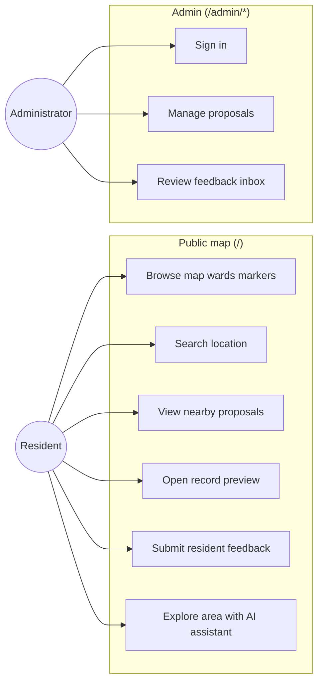
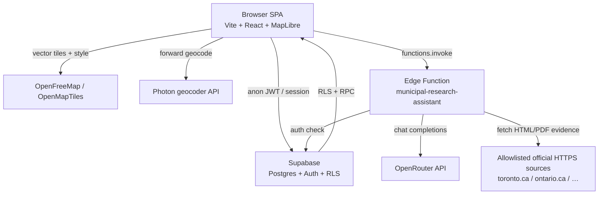
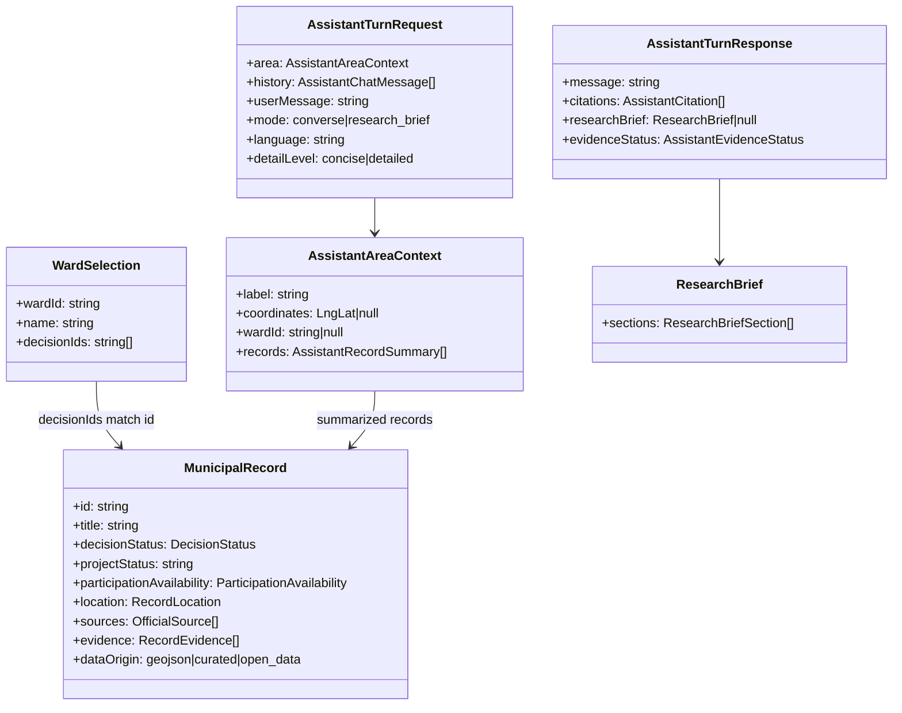
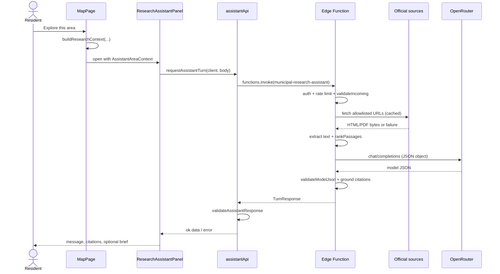
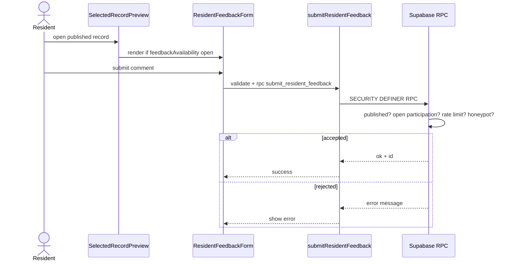

# UML and design diagrams

Diagrams use [Mermaid](https://mermaid.js.org/) and describe the **current** CivicSync implementation. They are design documentation, not generated code.

## 1. Use-case diagram

**Purpose:** Show primary actors and the major use cases the product actually supports.

**Requirements addressed:** F-MAP-*, F-FB-*, F-AI-*, F-ADM-*.

---

## 2. Component diagram

**Purpose:** Show major deployable/runtime components and trust boundaries.

**Requirements addressed:** F-MAP-01/05, F-AI-02/03, N-SEC-01/03, F-PUB-01.

---

## 3. Class / type diagram (domain core)

**Purpose:** Capture the central TypeScript domain types and their relationships (logical class diagram).

**Requirements addressed:** F-MAP-03/04, F-AI-01/04/05.

---

## 4. Sequence — Explore this area → assistant turn

**Purpose:** Show the runtime call chain for an AI research turn, including evidence retrieval and validation.

**Requirements addressed:** F-AI-01…F-AI-06, N-SEC-01/02, N-PERF-02.

---

## 5. Sequence — Resident feedback submit

**Purpose:** Show client gating vs server enforcement for feedback.

**Requirements addressed:** F-FB-01/02, N-SEC-02/03.

---

## 6. How diagrams map to requirements

| Diagram | Primary requirements |
| --- | --- |
| Use case | Product scope / actor goals |
| Component | Trust boundaries, no Express backend, secret placement |
| Class/types | Municipal + assistant domain contracts |
| Assistant sequence | Evidence retrieval + OpenRouter + validation |
| Feedback sequence | Double enforcement (UI + RPC) |
